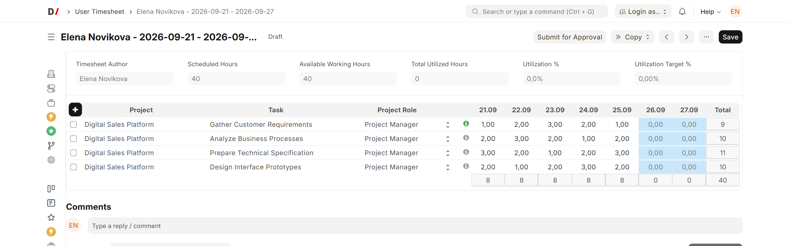
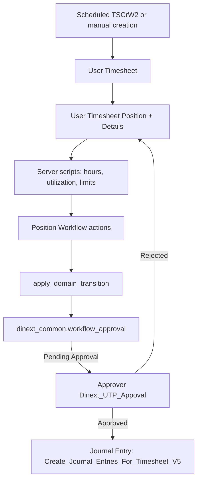
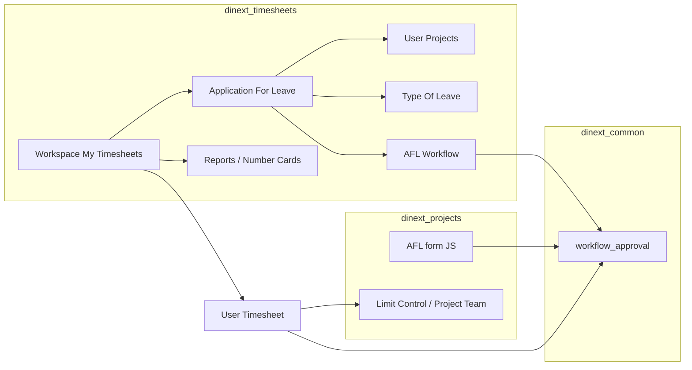

[Русский](README.ru.md)

<!-- dinext-presentation:start -->
<p align="center">
  <a href="https://dinext.ru"></a>
</p>
<h1 align="center">Dinext Timesheets</h1>

<hr>

<p align="center">Track working time, employee availability, leave and approvals across projects and tasks.</p>

<p align="center">
  
</p>
<p align="center"><sub>Time recording by project and task with demonstration data.</sub></p>

<p align="center">
  <a href="https://dinext.ru">Website</a> · <a href="https://docs.dinext.ru">Documentation</a>
</p>
<!-- dinext-presentation:end -->

# Dinext Timesheets

## 📖 Overview

**Dinext Timesheets** is a Frappe application for the ERPNext Dinext stack. It handles time tracking (timesheets), leave applications and related approvals. The **Dinext Timesheets** module owns the core entities of this domain: **Worker**, **Working Hours On Date**, UT/AFL DocTypes, workflows, reports and the **My Timesheets** workspace.

Most behavior is defined by Frappe metadata (fixtures: client and server scripts, workflows, custom fields, permissions), rather than extensive Python controllers. Dependencies: **dinext_projects**, **dinext_projects_pl** (rate/cost center child DocTypes referenced by Worker), **doctype_permission**. Planned work effort and project utilization belong to **project_workload_assignment**. It is published on Dinext GitHub and installed through bench.

## ✨ Features

### Timesheets and utilization

- **User Timesheet**, **User Timesheet Position** and **User Timesheet Position Details** track time by project, Task/Issue, role and date, including planned/actual time, utilization, leave and reporting periods.
- **Timesheet Template**, **Doctype for Timesheet** and **Working Hours Table** provide time norms and posting targets; server scripts calculate hours and Journal Entries.
- `TSCrW2` schedules weekly timesheet creation from templates.
- The fixture template is `Внутренняя команда РФ` (internal Russian team).

### Leave

- **Application For Leave** — leave applications (Worker, Type Of Leave, projects through the **User Projects** child table, partial day).
- **Type Of Leave** — type reference data (fixtures include annual leave, time off, sick leave, unpaid leave/time off).
- The `AFL` calendar view for approved leave.

### Approvals

- **UTP Workflow** and **AFL Workflow** remain Frappe Workflow metadata owned by this application.
- Execution uses `dinext_common.workflow_approval` with `dinext_timesheets.workflow_approval` for position actions, pending approvers, digests and vote cascading.
- Position state keys are Editing → Pending Approval → Approved / Rejected. Timesheet status keys are Draft, Pending Approval, Rejected, Rework and Approved. Russian labels are provided in `translations/ru.csv`.
- **Timesheet Settings** recalculates the parent from ordered position-to-timesheet rules with Any or All thresholds; the first matching rule wins. “Move all positions” moves other positions to that rule's position state. Only one row may enable timesheet validation, performed before entering its target parent status. Defaults: any Rejected makes the parent Rejected without moving other positions; all Approved makes it Approved; any Editing makes it Rework and moves other positions to Editing; any Pending Approval with no Editing or Rejected makes it Pending Approval, validates completion and moves the other positions to Pending Approval. An empty timesheet remains Draft. A second table hides position states from the list, defaulting to Editing, Not Set and Rejected; those positions remain visible on the parent form.
- Opening a `User Timesheet Position` form redirects to its parent User Timesheet.
- Fixture roles include `Dinext_UTP_Appoval` and `Dinext_UT_Full_Access`; `Dinext_Worker` remains owned by **dinext_projects**.
- AFL date UX and its pending-approver indicator belong to `dinext_projects`.

### Reports

| Report | Type | Reference DocType |
|-------|-----|-----------------|
| Timesheet Report | Script Report | User Timesheet Position |
| Contractor Report | Script Report | User Timesheet Position |
| Utilization Report | Report Builder | User Timesheet |
| Timesheet Statistics | Report Builder | User Timesheet |

### Workspace, cards and notifications

- **My Timesheets** combines Number Cards, reports and the AFL calendar. Approval cards use `dinext_common.workflow_approval.api.get_legacy_number_card_result`; the deadline-control section adds discipline cards and charts.
- Retained Notifications for unsubmitted timesheets and task limits are disabled (`enabled=0`). The legacy approval Notification was removed; approval mail uses `dinext_common` templates.

### Automations and extensions

- Client/server script fixtures calculate hours, limits, utilization and Journal Entries, copy positions and track Task/Issue delays. Approval and `set_timesheet_status` scripts were removed from fixtures.
- Domain extensions include `Task.custom_include`, `Issue.custom_include`, `Journal Entry.custom_user_timesheet`, `Project.custom_holidays_and_working_days` and `Project.custom_working_hours_on_date`.
- **Worker** is owned by this module. Its `worker_level`, `cost_center_table` and `utilization` tables reference child DocTypes owned by PL/PWA.
- Permissions use `Custom DocPerm` and `DocType Permission`, including `UT_Permissions-1`, `UTP_Permissions-1`, `Timesheet_Template_Permissions-1` and `AFL_Permissions-1`.
- Translations: `dinext_timesheets/translations/ru.csv`.

## 🚀 Installation

The Workflow email/deadline features documented below are currently prepared on `feat/dinext_workflow`. For a disposable local acceptance bench, select that branch for Common, Projects and Timesheets with `bench get-app --branch feat/dinext_workflow <repository-url>`. The general installation commands below do not select this feature revision. Use an accepted release tag for deployment; this branch has not completed the develop → release → main route.


```bash
cd $PATH_TO_YOUR_BENCH

# Dependencies (if not installed yet)
bench get-app --branch dinext/main/main https://github.com/Dinext-pro/doctype_permission.git
bench get-app https://github.com/Dinext-pro/dinext-projects.git

# Application
bench get-app https://github.com/Dinext-pro/dinext-timesheets.git --branch develop
bench --site <site> install-app dinext_timesheets
bench --site <site> migrate
bench --site <site> clear-cache
```

The `Worker.utilization` child table belongs to `project_workload_assignment`. A bench that creates Worker records needs that app as well: install it after Timesheets to satisfy its existing dependency order. A minimal metadata-only installation of the apps listed above does not provide that child controller.

After `install-app` / `migrate`, fixtures from `dinext_timesheets/fixtures/` are loaded (scripts, workflows, roles, permissions, custom fields, etc.).

The site update sequence (frontend build → `bench build` → `clear-cache`) is documented in central `dinext-docs`, `agents/ide/guides/frappe/app-structure.md`, section 3.3.

## 🛠️ Usage

### User workflow

1. Open **My Timesheets**; `Dinext_Worker` typically uses it as its home workspace.
2. Create or open a **User Timesheet** for the reporting period. Add **User Timesheet Position** rows with project, role, Task/Issue and dated hours.
3. The parent form offers submission, Workflow cancellation, editing and approval votes for its positions. The position form opens the parent. Approvers with `Dinext_UTP_Appoval` use **My Approvals** or list bulk actions (`bulk_vote` / `get_my_queue`).
4. Create **Application For Leave** with type, dates and **User Projects**, then use AFL Workflow.
5. Open timesheet, contractor, utilization and statistics reports from the workspace.

### Typical automations (server scripts)

| Script or method | Purpose |
|---|---|
| `TSCrW2` | Scheduled timesheet creation from templates |
| `UT_Hours_Calculate_V4` / `All_Hours_Calculate` | UT / UTP hour calculation |
| `Utilization_Hours_V2` | Position utilization |
| `Create_Journal_Entries_For_Timesheet_V5` | Timesheet Journal Entries |
| `Task Limit Exceeded_V4` | Task limit validation |
| `Copy_Positions_From_Previous_Timesheet` | Copy prior-period positions |
| `AFL_Calculate_Hours` | Leave hours |
| `apply_timesheet_position_action` | Apply a Workflow action to timesheet positions |

### Module document types

| DocType | Purpose |
|---------|------------|
| User Timesheet | A user's timesheet for a period |
| User Timesheet Position | Time booking position |
| User Timesheet Position Details | Hours by date |
| Timesheet Template | Template for working hour norms and rules |
| Doctype for Timesheet | Permitted time booking targets |
| Working Hours On Date | Reference data for shortened/special working days |
| Working Hours Table | Child table: hours on a date |
| Worker | Worker record / identity in the timesheet domain |
| Application For Leave | Leave application |
| User Projects | AFL child table: application projects |
| Type Of Leave | Leave type |

### Workflow notifications and deadline control

UTP and AFL inherit approval digests at `08:00, 17:00` and use separate correction mail in Rejected. UTP uses specialized Timesheet templates; AFL uses the general templates. Actual permissions and current creator flags are checked by Common before formation. The recipient's Workflow checkbox in Notification Settings controls ordinary and overdue emails.

The ordinary UTP digest groups parents by author, retains canonical row numbers from the parent card and labels each position **project — task — role** with a parent-timesheet link. Pending position counts/hours are shown. A position total includes its nonzero detail hours and comments in stored order, including fractions. Correction mail identifies the rejected position and the exact return comment, with only a parent link and no transition buttons.

The approved manager escalation threshold is **3 Working Days** in the approver's Worker calendar, reconfirmed on 11 November 2026; short working dates count as days. The current Worker user-group manager receives overdue digests at `08:00, 17:00`. This manager mail lists parent timesheets with responsible approvers, deadlines and delay; it has no child positions, author grouping or action buttons. Existing assignments retain their frozen deadline policy; safe backfill preserves known assignment time and marks unknown history explicitly.

In **My Timesheets**, **Deadline Control** follows **My Approvals** and contains discipline Number Cards and two standard charts showing overdue submission/approval counts by responsible user. **Timesheet Deadline Discipline** is linked from **Timesheet Reports**. The last sections are **Timesheet Reports** and **Timesheet Configuration**. Submission and approval discipline are separate; missing historical evidence does not become a fabricated on-time result. Empty percentages show a translated no-observations value. Rows, cards and chart inputs enforce access to the timesheet/task.

```bash
bench --site your-test-site.local run-tests --module dinext_timesheets.tests.test_workflow_email_details
bench --site your-test-site.local run-tests --module dinext_timesheets.tests.test_deadline_integration
bench --site your-test-site.local run-tests --module dinext_timesheets.tests.test_deadline_workspace_charts
```

`workflow_email.py` supplies business labels and existing detail rows, `workflow_approval.py` orchestrates position actions, `deadlines.py` and submission-discipline modules supply reports, and `setup/workflow_deadlines.py` configures UTP's default escalation. Calendar/manager providers belong to `dinext_projects`; templates, delivery, signed confirmation and the shared deadline engine belong to `dinext_common`.

## 📦 Technologies

| Technology | Usage |
|------------|---------------|
| Python 3.10+ | DocType controllers, Script Report, notification context |
| JavaScript | Form and list client scripts (fixtures), report JS |
| Frappe / ERPNext | DocType, hooks, fixtures, Workflow, Workspace |
| MariaDB / PostgreSQL | Document storage (through the Frappe ORM) |
| doctype_permission | Flexible DocType permissions (`DocType Permission`) |
| ruff / eslint / prettier | Code checks and formatting (pre-commit, CI) |

## 🔧 Configuration

Main configuration: `dinext_timesheets/hooks.py`:

| Setting | Description |
|---|---|
| `app_*` | Application metadata: name, publisher, GPL-3 |
| `fixtures` | Export/import Type Of Leave, Workflow metadata, Calendar View, extensions, scripts, Timesheet Template, roles and permissions |
| `required_apps` | `dinext_common`, `dinext_projects`, `dinext_projects_pl`, `doctype_permission` |
| `doctype_js` / `doctype_list_js` | UT form: `user_timesheet/entry.js`; UTP form/list: `user_timesheet_position_form.js`, `user_timesheet_position_list.js` |
| `workflow_approval_*` | Domain hooks for locking, pending approvers, completed votes, digests and email context/access |

Environment: a standard Frappe site (bench `site_config.json`). The application introduces no separate environment variables.

Export fixtures after making changes on the site:

```bash
bench --site <site> export-fixtures --app dinext_timesheets
```

## ✅ Requirements

- [Frappe Bench](https://github.com/frappe/bench) with the supported Frappe/ERPNext versions.
- Python >= 3.10 (`pyproject.toml`).
- Install all `required_apps`, including **doctype_permission**, **dinext_common**, **dinext_projects** and **dinext_projects_pl**.
- **Worker** and **Working Hours On Date** are owned by `dinext_timesheets`; project reference data, team/role/limit support and `Dinext_Worker` come from `dinext_projects`.

## 🤝 Contributing

```bash
cd apps/dinext_timesheets
pre-commit install
```

Before a commit: ruff, eslint, prettier, pyupgrade (see [`.pre-commit-config.yaml`](.pre-commit-config.yaml)). CI: [`.github/workflows/linters.yml`](.github/workflows/linters.yml) (Frappe Semgrep rules).

Shared development rules live in the central `dinext-docs` repository; start with this application’s [AGENTS.md](AGENTS.md).

## 📄 Documentation

| Resource | Description |
|---|---|
| [AGENTS.md](AGENTS.md) | Central registry, developer guide and mandatory OpenSpec navigation |
| [Dinext documentation](https://docs.dinext.ru) | Product and platform documentation |
| `dinext-docs` → `agents/ide/skills/readme-writer/` | Canonical bilingual README instructions |
| `dinext-docs` → `agents/ide/guides/frappe/app-structure.md` | Application structure, hooks and deployment checklist (§3.3) |
| [Frappe hooks](https://frappeframework.com/docs/user/en/python-api/hooks) | Hook documentation |
| [license.txt](license.txt) | GPL-3 license |

## 📝 Changelog

| Date | Commit | Change |
|---|---|---|
| 2026-09-10 | — | Parallel approval: `orchestrate_timesheet`, `workflow_approval_*` hooks and form/list JS; old status scripts and approval Notification removed |
| 2026-07-29 | `0190ee8` | Initial application commit (`feat: Initialize App`) |

The subsequent migration of the timesheet domain from dinext_projects (reports, number cards, notifications, User Projects, translations, etc.) is reflected in the working tree on top of this commit.

## 🗂️ Repository Structure

```
dinext_timesheets/                      # Repository root / Frappe application
├── README.md                           # Project documentation
├── AGENTS.md                           # Central dinext-docs pointer
├── license.txt                         # GPL-3 license
├── pyproject.toml                      # Metadata, Ruff, Python >=3.10
├── .pre-commit-config.yaml             # Pre-commit hooks
├── .editorconfig / .eslintrc           # Editor style and ESLint
├── .github/workflows/linters.yml       # CI Semgrep
├── .cursor/rules/                      # Local central-first IDE rules
└── dinext_timesheets/                  # Application Python package
    ├── __init__.py                     # __version__ = 0.0.1
    ├── hooks.py                        # Fixtures and Frappe integration
    ├── workflow_approval.py            # UT orchestration and domain hooks
    ├── modules.txt                     # Dinext Timesheets module
    ├── patches.txt / patches/          # Database patches
    ├── config/                         # Reserved by Bench
    ├── public/js/                      # UT/UTP approval forms and lists
    ├── templates/                      # Website template scaffold
    ├── translations/ru.csv             # Russian label translations
    ├── fixtures/                       # Scripts, workflows, roles and permissions
    └── dinext_timesheets/
        ├── doctype/                    # UT, UTP, AFL and templates
        ├── report/                     # Timesheet, utilization and discipline reports
        ├── number_card/                # Workspace Number Cards
        ├── notification/               # Two disabled Notifications
        └── workspace/мои_таймшиты/     # Desk workspace
```

| Path | Purpose |
|---|---|
| `hooks.py` | Fixtures, scoped DocType JS and domain hooks |
| `workflow_approval.py` | Position Workflow actions and `workflow_approval_*` adapters |
| `public/js/` | UT / UTP form and list behavior |
| `fixtures/` | Exported scripts, workflows, roles, extensions and permissions |
| `doctype/` | Domain DocType schemas and controllers |
| `report/` | Script Report and Report Builder reports |
| `number_card/`, `workspace/` | My Timesheets Desk UI |
| `notification/` | Disabled legacy notification templates/context |
| `translations/ru.csv` | Russian domain translations |
| `AGENTS.md` | Mandatory central instruction loading order |

## 🔗 Interaction Diagram

### Timesheet lifecycle



Position actions use a vote on an open task or `apply_domain_transition`. The first matching settings rule determines the parent status. The shared engine collects approval votes; reaching quorum retains the normal Journal Entry behavior.

### Leave application and dependencies


