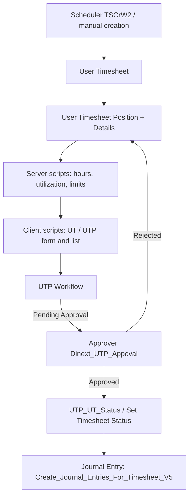
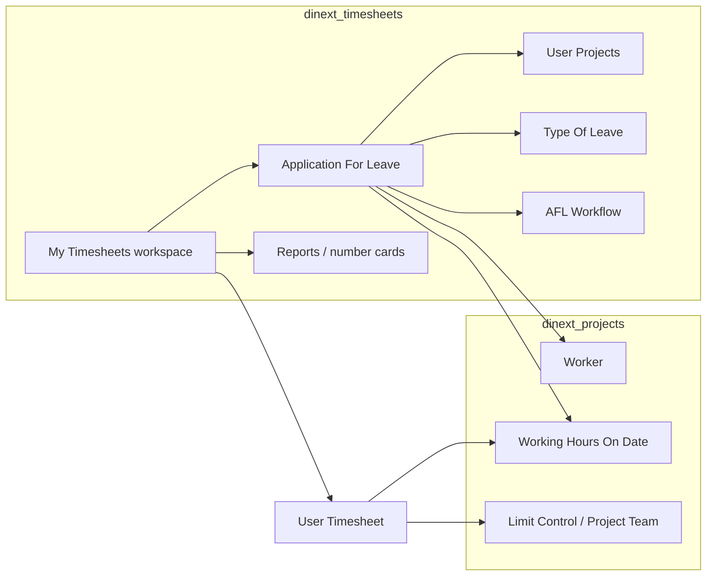

[Русский](README.ru.md)

<!-- dinext-presentation:start -->
<p align="center">
  <a href="https://dinext.ru"></a>
</p>
<h1 align="center">Dinext Timesheets</h1>

<hr>

<p align="center">Track working time, employee availability, leave and approvals across projects and tasks.</p>

<p align="center">
  
</p>
<p align="center"><sub>Time recording by project and task with demonstration data.</sub></p>

<p align="center">
  <a href="https://dinext.ru">Website</a> · <a href="https://docs.dinext.ru">Documentation</a>
</p>
<!-- dinext-presentation:end -->

# Dinext Timesheets

## 📖 Overview

**Dinext Timesheets** is a Frappe application for the ERPNext Dinext stack. It handles time tracking (timesheets), leave applications and related approvals. The **Dinext Timesheets** module owns the core entities of this domain: **Worker**, **Working Hours On Date**, UT/AFL DocTypes, workflows, reports and the **My Timesheets** workspace.

Most behavior is defined by Frappe metadata (fixtures: client and server scripts, workflows, custom fields, permissions), rather than extensive Python controllers. Dependencies: **dinext_projects**, **dinext_projects_pl** (rate/cost center child DocTypes referenced by Worker), **doctype_permission**. Planned work effort and project utilization belong to **project_workload_assignment**. It is published in Dinext GitLab and installed through bench.

## ✨ Features

### Timesheets and utilization

- **User Timesheet** / **User Timesheet Position** / **User Timesheet Position Details** — time tracking by project, Task/Issue, role and date (planned, actual, utilization, leave, reporting period).
- **Timesheet Template**, **Doctype for Timesheet**, **Working Hours Table** — ExampleCustomer08 for working hour norms and time booking targets; hours calculation and Journal Entry posting are implemented by server scripts.
- Automatic creation of weekly timesheets from a template (scheduler, `TSCrW2` server script).
- Fixture template: `Внутренняя команда РФ` (Internal Team RF).

### Leave

- **Application For Leave** — leave applications (Worker, Type Of Leave, projects through the **User Projects** child table, partial day).
- **Type Of Leave** — type reference data (fixtures include annual leave, time off, sick leave, unpaid leave/time off).
- The `AFL` calendar view for approved leave.

### Approvals

- **UTP Workflow** — approval of timesheet positions (`User Timesheet Position`).
- **AFL Workflow** — approval of leave applications.
- States: Editing → Pending Approval → Approved / Rejected.
- Fixture roles: `Dinext_UTP_Appoval`, `Dinext_UT_Full_Access` (the `Dinext_Worker` role remains in **dinext_projects**).

### Reports

| Report | Type | Reference DocType |
|-------|-----|-----------------|
| Timesheet Report | Script Report | User Timesheet Position |
| Contractor Report | Script Report | User Timesheet Position |
| Utilization Report | Report Builder | User Timesheet |
| Timesheet Statistics | Report Builder | User Timesheet |

### Workspace, cards and notifications

- **My Timesheets** workspace — 14 number cards, quick links to reports and the AFL calendar.
- Notifications (disabled in the repository, `enabled=0`): **Timesheet Not Submitted**, **Timesheet Approval**, **Task Limit**.

### Automations and extensions

- Client scripts (19) / server scripts (28): hours calculation, limits, utilization, Journal Entry, position copying, Workflow Task integration, Task/Issue overdue tracking.
- Custom fields in the `Dinext Timesheets` module:
  - `Task.custom_include`, `Issue.custom_include`
  - `Journal Entry.custom_user_timesheet`
  - `Project.custom_holidays_and_working_days`, `Project.custom_working_hours_on_date`
  - the core `Worker` DocType (`worker_level` / `cost_center_table` / `utilization` table fields remain on Worker; child DocTypes belong to PL/PWA)
- Permissions: `Custom DocPerm` and `DocType Permission` (`UT_Permissions-1`, `UTP_Permissions-1`, `Timesheet_Template_Permissions-1`, `AFL_Permissions-1`).
- Translations: `dinext_timesheets/translations/ru.csv`.

## 🚀 Installation

```bash
cd $PATH_TO_YOUR_BENCH

# Dependencies (if not installed yet)
bench get-app https://github.com/kittiu/doctype_permission.git
bench get-app https://dinext.gitlab.yandexcloud.net/erpnext/dinext/dinext-projects.git

# Application
bench get-app https://dinext.gitlab.yandexcloud.net/erpnext/dinext/dinext-timesheets.git --branch develop
bench --site <site> install-app dinext_timesheets
bench --site <site> migrate
bench --site <site> clear-cache
```

After `install-app` / `migrate`, fixtures from `dinext_timesheets/fixtures/` are loaded (scripts, workflows, roles, permissions, custom fields, etc.).

Application update order on the site: frontend build → `bench build` → `clear-cache`.

## 🛠️ Usage

### User workflow

1. Open the **My Timesheets** workspace (the `Dinext_Worker` role normally points here as its home page from **dinext_projects**).
2. Create or open a **User Timesheet** for the reporting period; positions are added as **User Timesheet Position** (project, role, Task/Issue, hours by date).
3. Submit positions for approval (UTP workflow). An approver with the `Dinext_UTP_Appoval` role handles the transitions.
4. For leave, create an **Application For Leave**, specify the type, dates and projects (**User Projects** table), and submit it through AFL Workflow.
5. Reports are available from the workspace: timesheets, contractors, utilization and statistics.

### Typical automations (server scripts)

| Script | Purpose |
|--------|------------|
| `TSCrW2` | Scheduler: automatic creation of timesheets from a template |
| `UT_Hours_Calculate_V4` / `All_Hours_Calculate` | UT / UTP hours calculation |
| `Utilization_Hours_V2` | Utilization by position |
| `Create_Journal_Entries_For_Timesheet_V5` | Creating Journal Entry records from a timesheet |
| `Task Limit Exceeded_V4` | Task limit checks |
| `Copy_Positions_From_Previous_Timesheet` | Copying positions from the previous period |
| `AFL_Calculate_Hours` | Hours for a leave application |

### Module document types

| DocType | Purpose |
|---------|------------|
| User Timesheet | A user's timesheet for a period |
| User Timesheet Position | Time booking position |
| User Timesheet Position Details | Hours by date |
| Timesheet Template | Template for working hour norms and rules |
| Doctype for Timesheet | Permitted time booking targets |
| Working Hours On Date | Reference data for shortened/special working days |
| Working Hours Table | Child table: hours on a date |
| Worker | Worker record / identity in the timesheet domain |
| Application For Leave | Leave application |
| User Projects | AFL child table: application projects |
| Type Of Leave | Leave type |

## 📦 Technologies

| Technology | Usage |
|------------|---------------|
| Python 3.10+ | DocType controllers, Script Report, notification context |
| JavaScript | Form and list client scripts (fixtures), report JS |
| Frappe / ERPNext | DocType, hooks, fixtures, Workflow, Workspace |
| MariaDB / PostgreSQL | Document storage (through the Frappe ORM) |
| doctype_permission | Flexible DocType permissions (`DocType Permission`) |
| ruff / eslint / prettier | Code checks and formatting (pre-commit, CI) |

## 🔧 Configuration

Main configuration: `dinext_timesheets/hooks.py`:

| Parameter | Description |
|----------|----------|
| `app_*` | Application metadata (name, publisher, GPL-3) |
| `fixtures` | Export and import of Type Of Leave, Workflow*, Calendar View, Custom Field / Property Setter, client and server scripts, Timesheet Template, Role, Custom DocPerm, DocType Permission |
| `required_apps` | `dinext_common`, `dinext_projects`, `dinext_projects_pl`, `doctype_permission` |

Environment: a standard Frappe site (bench `site_config.json`). The application introduces no separate environment variables.

Export fixtures after making changes on the site:

```bash
bench --site <site> export-fixtures --app dinext_timesheets
```

## ✅ Requirements

- [Administrator](https://github.com/frappe/bench) with Frappe/ERPNext installed (version according to your bench).
- Python >= 3.10 (`pyproject.toml`).
- Usually installed: **doctype_permission**, **dinext_projects**.
- Still required from **dinext_projects**: **Worker**, **Working Hours On Date**, Project Team / Project Role / Limit Control / Project Work Efforts, and the `Dinext_Worker` role.

## 🤝 Contributing

```bash
cd apps/dinext_timesheets
pre-commit install
```

Before a commit: ruff, eslint, prettier, pyupgrade (see [`.pre-commit-config.yaml`](.pre-commit-config.yaml)). CI: [`.github/workflows/linters.yml`](.github/workflows/linters.yml) (Frappe Semgrep rules).

Common Dinext development rules: [AGENTS.md](AGENTS.md).

## 📄 Documentation

| Resource | Description |
|--------|----------|
| [AGENTS.md](AGENTS.md) | Agent navigation: registry, developer guide |
| [Frappe hooks](https://frappeframework.com/docs/user/en/python-api/hooks) | Hooks documentation |
| [license.txt](license.txt) | GPL-3 license |

## 📝 Changelog

| Date | Commit | Changes |
|------|--------|-----------|
| 2026-07-29 | `0190ee8` | Initial application commit (`feat: Initialize App`) |

The subsequent migration of the timesheet domain from dinext_projects (reports, number cards, notifications, User Projects, translations, etc.) is reflected in the working tree on top of this commit.

## 🗂️ Repository Structure

```
dinext_timesheets/                      # Repository root / Frappe application
├── README.md                           # Project documentation
├── AGENTS.md                           # Agent instructions
├── license.txt                         # GPL-3 license
├── pyproject.toml                      # Metadata, ruff, Python >=3.10
├── .pre-commit-config.yaml             # Pre-commit hooks
├── .editorconfig / .eslintrc           # Editor style and ESLint
├── .github/workflows/linters.yml       # CI Semgrep
├── .cursor/rules/                      # Local IDE rules: central-first
└── dinext_timesheets/                  # Application Python package
    ├── __init__.py                     # __version__ = 0.0.1
    ├── hooks.py                        # Fixtures and Frappe integration
    ├── modules.txt                     # Dinext Timesheets module
    ├── patches.txt / patches/          # Database patches
    ├── config/                         # Reserved for bench
    ├── public/                         # Frontend assets (scaffold)
    ├── templates/                      # Web ExampleCustomer08 (scaffold)
    ├── translations/ru.csv             # Russian label translations
    ├── fixtures/                       # Scripts, workflows, roles, permissions, …
    └── dinext_timesheets/
        ├── doctype/                    # UT, UTP, AFL, ExampleCustomer08, …
        ├── report/                     # 4 timesheet / utilization reports
        ├── number_card/                # 14 workspace cards
        ├── notification/               # 3 notifications
        └── workspace/мои_таймшиты/     # Desk workspace
```

| Path | Purpose |
|------|------------|
| `hooks.py` | Integration point: fixture export |
| `fixtures/` | Portable scripts, workflows, roles, custom fields, permissions |
| `doctype/` | Schemas and thin controllers for the module's document types |
| `report/` | Script Report and Report Builder reports |
| `number_card/`, `workspace/` | My Timesheets Desk interface |
| `notification/` | ExampleCustomer08 and Python context for notifications |
| `translations/ru.csv` | Localization of timesheet domain strings |
| `AGENTS.md` | Mandatory central instruction loading order |

## 🔗 Interaction Diagram

### Timesheet lifecycle



### Leave application and dependencies


