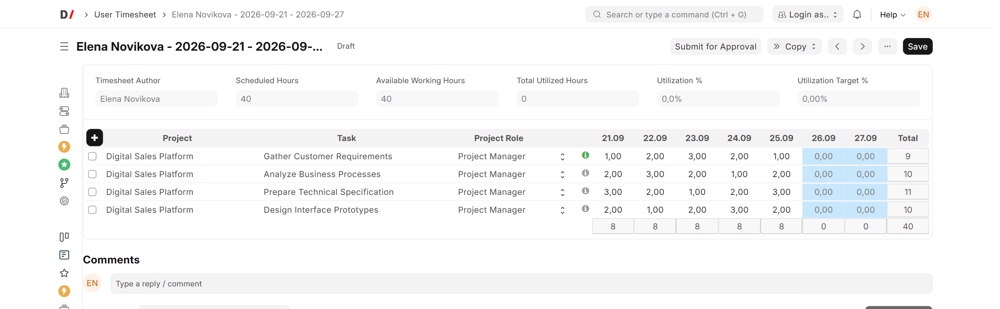
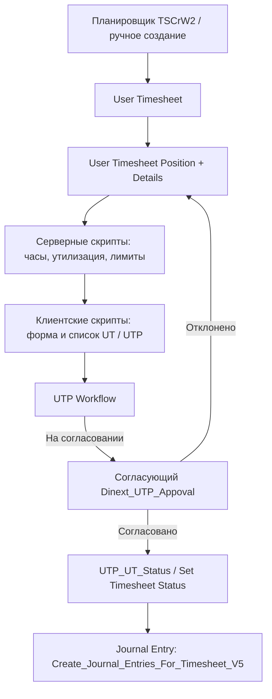
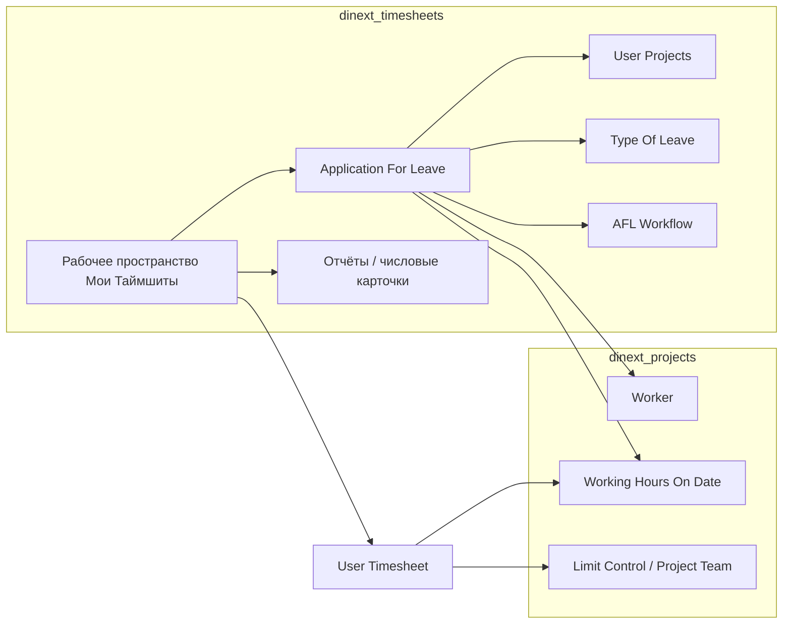

[English](README.md)

<!-- dinext-presentation:start -->
<p align="center">
  <a href="https://dinext.ru"></a>
</p>
<h1 align="center">Dinext Timesheets</h1>

<hr>

<p align="center">Учёт рабочего времени, доступности сотрудников, отпусков и согласований по проектам и задачам.</p>

<p align="center">
  
</p>
<p align="center"><sub>Учёт времени по проектам и задачам на демонстрационных данных.</sub></p>

<p align="center">
  <a href="https://dinext.ru">Сайт</a> · <a href="https://docs.dinext.ru">Документация</a>
</p>
<!-- dinext-presentation:end -->

# Dinext Timesheets

## 📖 Обзор

**Dinext Timesheets** — приложение на платформе Frappe для стека ERPNext Dinext. Оно отвечает за учёт рабочего времени (таймшиты), заявки на отсутствие и связанные согласования. Модуль **Dinext Timesheets** владеет базовыми сущностями контура: **Worker**, **Working Hours On Date**, UT/AFL DocType, workflow, отчёты и workspace **Мои Таймшиты**.

Большая часть поведения задаётся метаданными Frappe (фикстуры: клиентские и серверные скрипты, workflow, пользовательские поля, права), а не объёмными Python-контроллерами. Зависимости: **dinext_projects**, **dinext_projects_pl** (child DocTypes ставок/ЦФО, на которые ссылается Worker), **doctype_permission**. Плановые трудозатраты и project utilization принадлежат **project_workload_assignment**. Публикуется в GitLab Dinext, устанавливается через bench.

## ✨ Возможности

### Таймшиты и утилизация

- **User Timesheet** / **User Timesheet Position** / **User Timesheet Position Details** — учёт времени по проектам, Task/Issue, ролям и датам (план, факт, утилизация, отпуска, отчётный период).
- **Timesheet Template**, **Doctype for Timesheet**, **Working Hours Table** — ExampleCustomer08 норм и объекты списания; расчёт часов и проводок Journal Entry — серверные скрипты.
- Автосоздание недельных таймшитов по шаблону (планировщик, серверный скрипт `TSCrW2`).
- Шаблон в фикстурах: `Внутренняя команда РФ`.

### Отпуска

- **Application For Leave** — заявки на отсутствие (Worker, Type Of Leave, проекты через дочернюю таблицу **User Projects**, частичный день).
- **Type Of Leave** — справочник типов (в фикстурах: ежегодный отпуск, отгул, больничный, отпуск/отгул за свой счёт).
- Представление календаря `AFL` для согласованных отсутствий.

### Согласования

- **UTP Workflow** — согласование позиций таймшита (`User Timesheet Position`).
- **AFL Workflow** — согласование заявок на отсутствие.
- Состояния: Редактирование → На согласовании → Согласовано / Отклонено.
- Роли в фикстурах: `Dinext_UTP_Appoval`, `Dinext_UT_Full_Access` (роль `Dinext_Worker` остаётся в **dinext_projects**).

### Отчёты

| Отчёт | Тип | Базовый DocType |
|-------|-----|-----------------|
| Отчет по ТШ | Script Report | User Timesheet Position |
| Отчет для Подрядчиков | Script Report | User Timesheet Position |
| Отчет по утилизации | Report Builder | User Timesheet |
| Статистика по ТШ | Report Builder | User Timesheet |

### Рабочее пространство, карточки, уведомления

- Рабочее пространство **Мои Таймшиты** — 14 числовых карточек, быстрые ссылки на отчёты и календарь AFL.
- Уведомления (в репозитории выключены, `enabled=0`): **Таймшит не отправлен**, **Согласоанияе ТШ**, **Лимит по Задаче**.

### Автоматизации и расширения

- Клиентские скрипты (19) / серверные скрипты (28): расчёт часов, лимиты, утилизация, Journal Entry, копирование позиций, интеграция с Workflow Task, просрочки по Task/Issue.
- Пользовательские поля модуля `Dinext Timesheets`:
  - `Task.custom_include`, `Issue.custom_include`
  - `Journal Entry.custom_user_timesheet`
  - `Project.custom_holidays_and_working_days`, `Project.custom_working_hours_on_date`
  - базовый DocType `Worker` (table fields `worker_level` / `cost_center_table` / `utilization` остаются на Worker; child DocTypes — у PL/PWA)
- Права: `Custom DocPerm` и `DocType Permission` (`UT_Permissions-1`, `UTP_Permissions-1`, `Timesheet_Template_Permissions-1`, `AFL_Permissions-1`).
- Переводы: `dinext_timesheets/translations/ru.csv`.

## 🚀 Установка

```bash
cd $PATH_TO_YOUR_BENCH

# Зависимости (если ещё не установлены)
bench get-app https://github.com/kittiu/doctype_permission.git
bench get-app https://dinext.gitlab.yandexcloud.net/erpnext/dinext/dinext-projects.git

# Приложение
bench get-app https://dinext.gitlab.yandexcloud.net/erpnext/dinext/dinext-timesheets.git --branch develop
bench --site <site> install-app dinext_timesheets
bench --site <site> migrate
bench --site <site> clear-cache
```

После `install-app` / `migrate` подтягиваются фикстуры из `dinext_timesheets/fixtures/` (скрипты, workflow, роли, права, пользовательские поля и др.).

Порядок обновления приложения на сайте: сборка frontend → `bench build` → `clear-cache`.

## 🛠️ Использование

### Рабочий контур пользователя

1. Откройте рабочее пространство **Мои Таймшиты** (роль `Dinext_Worker` обычно ведёт сюда как домашнюю страницу из **dinext_projects**).
2. Создайте или откройте **User Timesheet** за отчётный период; позиции добавляются как **User Timesheet Position** (проект, роль, Task/Issue, часы по датам).
3. Отправьте позиции на согласование (workflow UTP). Согласующий с ролью `Dinext_UTP_Appoval` обрабатывает переходы.
4. Для отсутствия создайте **Application For Leave**, укажите тип, даты и проекты (таблица **User Projects**), отправьте по AFL Workflow.
5. Отчёты доступны из рабочего пространства: по ТШ, для подрядчиков, по утилизации, статистика.

### Типовые автоматизации (серверные скрипты)

| Скрипт | Назначение |
|--------|------------|
| `TSCrW2` | Планировщик: автосоздание таймшитов по шаблону |
| `UT_Hours_Calculate_V4` / `All_Hours_Calculate` | Расчёт часов UT / UTP |
| `Utilization_Hours_V2` | Утилизация по позиции |
| `Create_Journal_Entries_For_Timesheet_V5` | Создание Journal Entry по таймшиту |
| `Task Limit Exceeded_V4` | Проверка лимитов по задаче |
| `Copy_Positions_From_Previous_Timesheet` | Копирование позиций с прошлого периода |
| `AFL_Calculate_Hours` | Часы по заявке на отсутствие |

### Типы документов модуля

| DocType | Назначение |
|---------|------------|
| User Timesheet | Таймшит пользователя за период |
| User Timesheet Position | Позиция списания |
| User Timesheet Position Details | Часы по датам |
| Timesheet Template | Шаблон норм и правил |
| Doctype for Timesheet | Допустимые объекты списания |
| Working Hours On Date | Справочник сокращённых/особых рабочих дней |
| Working Hours Table | Дочерняя таблица: часы на дату |
| Worker | Карточка исполнителя / identity таймшитного контура |
| Application For Leave | Заявка на отсутствие |
| User Projects | Дочерняя таблица AFL: проекты заявки |
| Type Of Leave | Тип отсутствия |

## 📦 Технологии

| Технология | Использование |
|------------|---------------|
| Python 3.10+ | Контроллеры DocType, Script Report, контекст уведомлений |
| JavaScript | Клиентские скрипты форм и списков (фикстуры), JS отчётов |
| Frappe / ERPNext | DocType, hooks, фикстуры, Workflow, Workspace |
| MariaDB / PostgreSQL | Хранение документов (через ORM Frappe) |
| doctype_permission | Гибкие права на DocType (`DocType Permission`) |
| ruff / eslint / prettier | Проверка и форматирование кода (pre-commit, CI) |

## 🔧 Конфигурация

Основная конфигурация — `dinext_timesheets/hooks.py`:

| Параметр | Описание |
|----------|----------|
| `app_*` | Метаданные приложения (имя, издатель, GPL-3) |
| `fixtures` | Экспорт и импорт Type Of Leave, Workflow*, Calendar View, Custom Field / Property Setter, клиентских и серверных скриптов, Timesheet Template, Role, Custom DocPerm, DocType Permission |
| `required_apps` | `dinext_common`, `dinext_projects`, `dinext_projects_pl`, `doctype_permission` |

Окружение: стандартный сайт Frappe (`site_config.json` bench). Отдельных переменных окружения приложение не вводит.

Экспорт фикстур после правок на сайте:

```bash
bench --site <site> export-fixtures --app dinext_timesheets
```

## ✅ Требования

- [Administrator](https://github.com/frappe/bench) с установленным Frappe/ERPNext (версия — по вашему bench).
- Python >= 3.10 (`pyproject.toml`).
- Обычно установлены: **doctype_permission**, **dinext_projects**.
- Из **dinext_projects** по-прежнему нужны: **Worker**, **Working Hours On Date**, Project Team / Project Role / Limit Control / Project Work Efforts, роль `Dinext_Worker`.

## 🤝 Участие в разработке

```bash
cd apps/dinext_timesheets
pre-commit install
```

Перед коммитом: ruff, eslint, prettier, pyupgrade (см. [`.pre-commit-config.yaml`](.pre-commit-config.yaml)). CI: [`.github/workflows/linters.yml`](.github/workflows/linters.yml) (правила Semgrep для Frappe).

Общие правила разработки Dinext: [AGENTS.md](AGENTS.md).

## 📄 Документация

| Ресурс | Описание |
|--------|----------|
| [AGENTS.md](AGENTS.md) | Навигация для агентов: реестр, руководство разработчика |
| [Frappe hooks](https://frappeframework.com/docs/user/en/python-api/hooks) | Документация по hooks |
| [license.txt](license.txt) | Лицензия GPL-3 |

## 📝 История изменений

| Дата | Коммит | Изменения |
|------|--------|-----------|
| 2026-07-29 | `0190ee8` | Начальный коммит приложения (`feat: Initialize App`) |

Дальнейшая миграция таймшитного контура из dinext_projects (отчёты, числовые карточки, уведомления, User Projects, переводы и др.) отражена в рабочем дереве поверх этого коммита.

## 🗂️ Структура репозитория

```
dinext_timesheets/                      # Корень репозитория / приложение Frappe
├── README.md                           # Документация проекта
├── AGENTS.md                           # Инструкции для агентов
├── license.txt                         # Лицензия GPL-3
├── pyproject.toml                      # Метаданные, ruff, Python >=3.10
├── .pre-commit-config.yaml             # Хуки pre-commit
├── .editorconfig / .eslintrc           # Стиль редактора и ESLint
├── .github/workflows/linters.yml       # CI Semgrep
├── .cursor/rules/                      # Локальные правила IDE: central-first
└── dinext_timesheets/                  # Python-пакет приложения
    ├── __init__.py                     # __version__ = 0.0.1
    ├── hooks.py                        # Фикстуры и интеграция с Frappe
    ├── modules.txt                     # Модуль «Dinext Timesheets»
    ├── patches.txt / patches/          # Патчи базы данных
    ├── config/                         # Зарезервировано bench
    ├── public/                         # Frontend-ресурсы (заготовка)
    ├── templates/                      # Веб-ExampleCustomer08 (заготовка)
    ├── translations/ru.csv             # Русские переводы подписей
    ├── fixtures/                       # Скрипты, workflow, роли, права, …
    └── dinext_timesheets/
        ├── doctype/                    # UT, UTP, AFL, ExampleCustomer08, …
        ├── report/                     # 4 отчёта по ТШ / утилизации
        ├── number_card/                # 14 карточек рабочего пространства
        ├── notification/               # 3 уведомления
        └── workspace/мои_таймшиты/     # Рабочее пространство Desk
```

| Путь | Назначение |
|------|------------|
| `hooks.py` | Точка интеграции: экспорт фикстур |
| `fixtures/` | Переносимые скрипты, workflow, роли, пользовательские поля, права |
| `doctype/` | Схемы и тонкие контроллеры типов документов модуля |
| `report/` | Отчёты Script Report и Report Builder |
| `number_card/`, `workspace/` | Интерфейс Desk «Мои Таймшиты» |
| `notification/` | ExampleCustomer08 и Python-контекст уведомлений |
| `translations/ru.csv` | Локализация строк таймшитного контура |
| `AGENTS.md` | Обязательный порядок загрузки центральных инструкций |

## 🔗 Схема взаимодействия

### Жизненный цикл таймшита



### Заявка на отсутствие и зависимости


